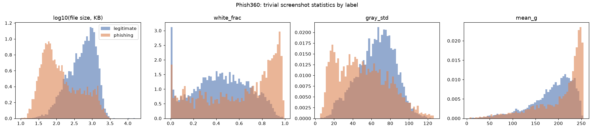
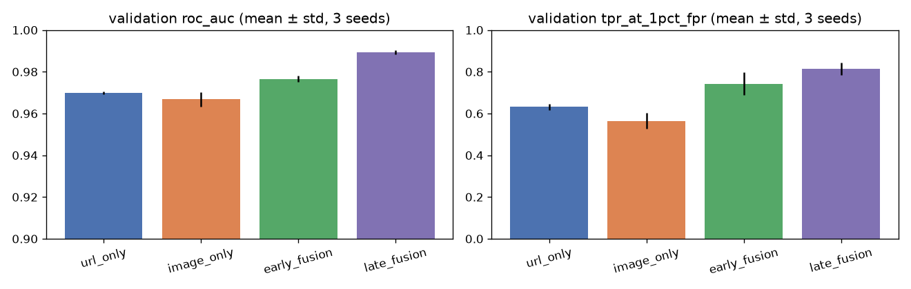
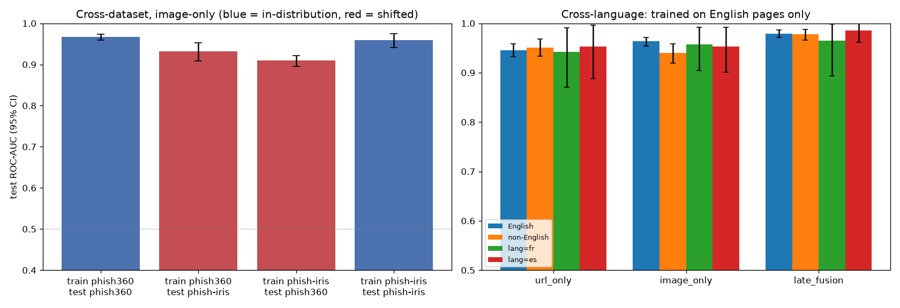
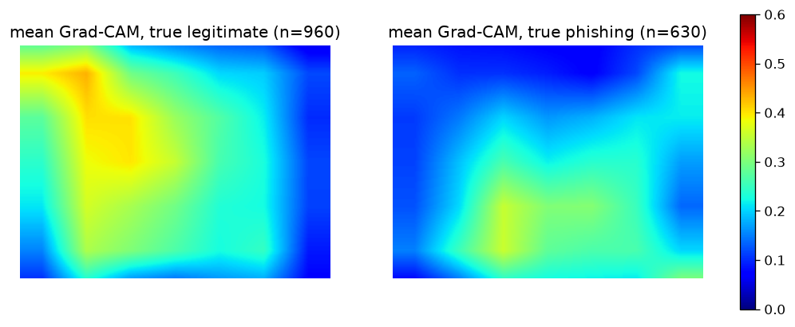
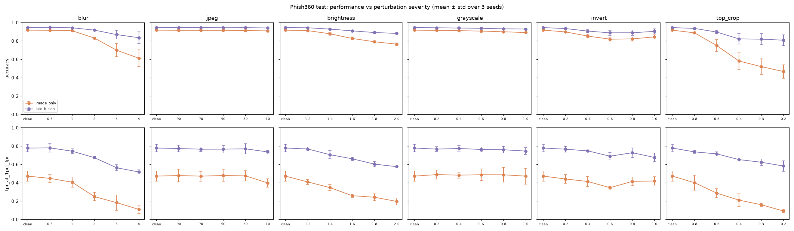

# Does a Screenshot Classifier Really See Phishing? A Generalization and Shortcut Study on Phish360 and Phish-IRIS

**Neural Network Lab report**, Department of CSE, BUBT. Author: Yousuf Sharif Fahim. November 2026.

All numbers in this report are produced by scripts in `src/` and stored in `results/`. File names are given in brackets.
Unless stated otherwise, scores are means over three training seeds (42, 43, 44), and test-set intervals are 95% bootstrap confidence intervals.

---

## Abstract

We study visual phishing detection with convolutional neural networks on two public datasets: Phish360 (10,748 URL/HTML/screenshot triplets, 2020-2023) and Phish-IRIS (2,849 screenshots of 14 imitated brands plus other pages, 2018). We compare a screenshot classifier with a URL-feature baseline and their fusion, and then test how far the screenshot model generalizes and what it relies on. On a leakage-controlled Phish360 test split, a fine-tuned MobileNetV3-small reaches ROC-AUC 0.967, a LightGBM URL model 0.961, and late fusion of the two 0.984. At a 1% false-positive rate, fusion catches 77% of phishing, against 59% for URL alone and 47% for the screenshot alone. However, trivial image statistics (file size, whiteness, mean colour) already reach ROC-AUC 0.853 on Phish360 and 0.995 on Phish-IRIS. On the 288 test pages where those statistics point the wrong way, the screenshot model falls to 0.809. Grad-CAM, occlusion and error analysis agree: the model mostly detects "sparse login-style page" rather than an imitated brand. Under distribution shift the screenshot model loses about 0.04-0.06 ROC-AUC across datasets (0.931 and 0.910) and across languages (0.964 to 0.940), and roughly half of its detection rate at a 1% false-positive rate. URL features and fusion are more stable. Our contribution is this generalization and shortcut analysis, not a new architecture.

## 1. Introduction

Phishing pages imitate the look of trusted brands, so detecting them from screenshots is attractive: an attacker can change a URL cheaply, but a page must still *look* like PayPal to fool a victim. Published screenshot classifiers report accuracies in the high 90s on standard datasets. High in-distribution accuracy, however, says little about whether a model has learned phishing cues or merely regularities of how a dataset was collected.

We ask five research questions:

- **RQ1.** Does a screenshot classifier beat URL features, and does fusing both help?
- **RQ2.** Does a detector trained on one era or dataset hold up on another (Phish-IRIS 2018 vs Phish360 2020-2023)?
- **RQ3.** Does it generalize across page languages (train on English, test on non-English)?
- **RQ4.** What visual cues does it rely on, and does it use shortcuts?
- **RQ5 (stretch).** Can it identify the imitated brand and reject brands it has never seen?

## 2. Related work

Visual similarity has long been used for phishing detection. **VisualPhishNet** (Abdelnabi, Krombholz and Fritz, ACM CCS 2020) learns a similarity metric between a page screenshot and a list of protected brands. **Phishpedia** (Lin et al., USENIX Security 2021) detects and matches brand logos and checks them against the page's domain. **Phish-IRIS** (Dalgic, Bozkir and Aydos, ISMSIT 2018; arXiv:1905.07767) introduced the brand-labelled screenshot dataset we use, and classified it with compact MPEG-7-style colour and edge descriptors. The Phish360 authors (Almakhamreh and Bozkir, *Applied Sciences* 16(2):751, 2026) released Phish360 together with **CrossPhire**, a jointly trained multimodal (URL, HTML, screenshot) detector. **Multimodal fusion on Phish360 is therefore not new, and we do not claim it as a contribution.** Our fusion experiment is a reproduction-scale ablation that serves the generalization and shortcut analysis.

Methodologically we build on transfer learning with ImageNet-pretrained backbones (ResNet, He et al., CVPR 2016; MobileNetV3, Howard et al., ICCV 2019; DeiT, Touvron et al., ICML 2021), gradient boosting (LightGBM, Ke et al., NeurIPS 2017), Grad-CAM (Selvaraju et al., ICCV 2017), and the *shortcut learning* perspective of Geirhos et al. (*Nature Machine Intelligence*, 2020): deep networks often solve a benchmark through an unintended, easier signal.

## 3. Datasets

**Phish360** (primary). There are 10,748 samples: 6,416 legitimate and 4,332 phishing across 46 imitated brands. Each sample has a URL, the raw HTML and a 1280x960 screenshot (99% of images have exactly this size). We found no corrupt images. Ten HTML files were missing; their screenshots and URLs were intact. There are no per-sample dates or language fields. We took labels from the sample folder names, because 86 `label.txt` files were empty and 8 held invalid values (`results/phase1/dataset_summary.json`).

**Phish-IRIS** (secondary). There are 2,849 screenshots in 15 classes: 14 brands (1,452 images) and "other" (1,397), which we map to phishing and legitimate respectively, following the authors' description of "other" as legitimate pages. Our copy is a Kaggle mirror: it has 1,312 training images instead of the 1,313 in the paper, and 1,537 test images instead of 1,539. There are no URLs or HTML.

### 3.1 Leakage control

Phishing kits are mass-deployed, so near-identical pages recur. We computed a 64-bit perceptual hash (pHash) of every screenshot, linked pairs within a Hamming distance of 6 bits, and also linked samples sharing a registered domain (parsed offline from the URL string). Connected components form **leakage groups**. Phish360's official split leaks: 429 of its 2,771 test samples (15.5%) share a group with its training portion. 80 of them have a near-duplicate screenshot there, and 356 share a registered domain (`results/phase1/leakage_report.json`). We therefore built our own grouped, label-stratified 70/15/15 splits (seed 42) with zero groups crossing splits. For Phish360 that gives 7,451 / 1,591 / 1,590 pages (`results/phase1/splits_summary.json`). 97 near-duplicate clusters are shared *between* the two datasets (208 Phish-IRIS and 247 Phish360 samples). These are removed from cross-dataset tests. The test split was used once, in the final evaluation.

### 3.2 Shortcut check

A LightGBM model on nine trivial statistics (width, height, aspect ratio, file size, mean R/G/B, fraction of white pixels, grey-level standard deviation, JPEG flag) predicts the label surprisingly well under grouped cross-validation (`results/phase1/shortcut_check.json`):

| Dataset | Trivial-feature ROC-AUC | TPR @ 1% FPR | Strongest single cues |
|---|---|---|---|
| Phish360 | 0.850 | 0.265 | file size (AUC 0.79, inverted), whiteness (0.67) |
| Phish-IRIS | **0.995** | 0.880 | aspect ratio (0.80), JPEG flag (0.79) |

On Phish360, image dimensions carry no signal (AUC 0.50). The signal is **page density**: legitimate samples are mostly busy homepages, while phishing samples are mostly sparse login forms. On Phish-IRIS, most "other" images are square 1024x1024 JPEGs and most brand pages are wide PNGs. We also excluded 168 near-blank screenshots (155 of them phishing), which are failed page loads where "blank" would mean "phishing".

## 4. Methods

**Image preprocessing.** Each screenshot is resized with Lanczos filtering and letterboxed onto a 224x224 canvas, keeping its aspect ratio and padding with the ImageNet mean colour (zero after normalisation). Letterboxing alone would still leak aspect ratio through the band width, so Phish-IRIS images are first top-cropped to the 4:3 viewport shape of Phish360. A second variant keeps only the top half of the page ("above the fold"). Augmentation is light (crops of 85-100% area, colour jitter, blur, JPEG re-compression) and uses **no horizontal flips**, because layout carries meaning.

**Image models.** We trained (a) a small CNN from scratch (4 conv blocks, 0.39M parameters); (b) MobileNetV3-small, ImageNet-pretrained and fully fine-tuned (1.5M parameters; AdamW, cosine schedule, early stopping on validation ROC-AUC with patience 4, at most 15 epochs); and (c) frozen ResNet18, DeiT-tiny and MobileNetV3 feature extractors with logistic-regression or MLP heads. Training ran on a 6-core CPU without a GPU. Backbones that would take more than 40 minutes per run to fine-tune were used frozen.

**URL baseline.** We extract 29 lexical features from the URL string only (lengths, character ratios, subdomain count, entropy, suspicious words, TLD, path structure, and so on) and train logistic regression, LightGBM and a 2-layer MLP. URLs are never fetched.

**Fusion.** *Early fusion* concatenates a standardised image embedding with the URL features and trains a 2-layer MLP. *Late fusion* averages the URL (LightGBM) and image (MobileNetV3) probabilities, with no fitted weights.

**Explainability and robustness.** We use Grad-CAM on the last MobileNetV3 block, and occlusion with a 32x32 grey patch on a 7x7 grid. We also train classifiers on only the outer 20-pixel ring of the page or only its central box. Finally, we apply six perturbations at five severities each.

**Metrics.** Precision, recall and F1 at threshold 0.5; ROC-AUC; and the true-positive rate at a 1% false-positive rate (TPR@1%FPR), because wrongly flagging legitimate sites is costly.

## 5. Results

### 5.1 RQ1: screenshot vs URL vs fusion

Validation results (`results/phase2/metrics_summary.csv`, `results/phase3/metrics_summary.csv`, `results/phase4/ablation_summary.csv`):

| Model (validation) | ROC-AUC | TPR@1%FPR | F1 |
|---|---|---|---|
| URL, logistic regression | 0.962 | 0.544 | 0.866 |
| URL, LightGBM | 0.970 ± 0.001 | 0.631 ± 0.014 | 0.884 |
| URL, MLP | 0.971 ± 0.001 | 0.614 ± 0.014 | 0.888 |
| Image, small CNN from scratch (1 seed) | 0.939 | 0.461 | 0.830 |
| Image, frozen ResNet18 + MLP | 0.954 ± 0.001 | 0.540 ± 0.069 | 0.870 |
| Image, frozen DeiT-tiny + MLP | 0.943 ± 0.001 | 0.435 ± 0.021 | 0.848 |
| Image, MobileNetV3 fine-tuned, top half | 0.952 ± 0.003 | 0.538 ± 0.026 | 0.865 |
| **Image, MobileNetV3 fine-tuned, full page** | **0.967 ± 0.003** | 0.565 ± 0.038 | 0.888 |
| Early fusion (fine-tuned MobileNetV3 embedding) | 0.977 ± 0.002 | 0.743 ± 0.055 | 0.914 |
| Early fusion (frozen ResNet18 embedding) | 0.987 ± 0.002 | 0.787 ± 0.011 | 0.933 |
| **Late fusion** | **0.989 ± 0.001** | **0.814 ± 0.031** | 0.933 |

Final, one-time test results (`results/final_in_distribution.csv`):

| Model (Phish360 test, n = 1,590) | ROC-AUC [95% CI] | TPR@1%FPR [95% CI] | Precision | Recall | F1 |
|---|---|---|---|---|---|
| Trivial statistics (floor) | 0.853 [0.832, 0.874] | 0.190 [0.046, 0.312] | 0.820 | 0.684 | 0.746 |
| URL only (LightGBM) | 0.961 [0.952, 0.969] | 0.587 [0.499, 0.661] | 0.878 | 0.834 | 0.855 |
| URL only, artifact features removed | 0.932 [0.918, 0.945] | 0.568 [0.469, 0.642] | 0.882 | 0.782 | 0.829 |
| Image only (MobileNetV3) | 0.967 [0.959, 0.974] | 0.472 [0.340, 0.601] | 0.922 | 0.866 | 0.892 |
| Early fusion (frozen ResNet18) | 0.983 [0.977, 0.988] | 0.705 [0.604, 0.796] | 0.926 | 0.931 | 0.929 |
| **Late fusion** | **0.984 [0.978, 0.989]** | **0.770 [0.682, 0.861]** | 0.957 | 0.904 | 0.929 |
| Late fusion, artifact URL features removed | 0.977 [0.968, 0.983] | 0.726 [0.651, 0.808] | 0.949 | 0.893 | 0.920 |

**Answer to RQ1.** The screenshot model and the URL model are statistically indistinguishable in ROC-AUC (their confidence intervals overlap). The URL model is better at the strict 1%-FPR operating point. Fusion clearly helps: both fused models beat both single modalities, and late fusion catches 77% of phishing at 1% FPR. The two modalities make different mistakes. Three caveats apply. (i) The strongest URL feature, `has_www` (26% of LightGBM gain), reflects how legitimate URLs were collected. Removing it together with TLD and path-structure features costs the URL model 0.03 AUC, but fusion keeps 0.977 (`results/phase2/feature_importance.csv`). (ii) Early fusion works better on frozen embeddings than on the fine-tuned network's, because the fine-tuned network partly memorised its training images, so a fusion head over-trusts it. (iii) In a robustness probe, late fusion falls back to the remaining modality when one is missing (blank screenshot: 0.970), while early fusion with a blank screenshot drops to 0.918, below URL-only (`results/phase4/robustness_summary.csv`).

### 5.2 RQ2: across datasets and time

Image-only MobileNetV3 trained on one dataset and tested on the other's test split, with shared near-duplicates removed (`results/phase5/cross_dataset.csv`):

| Train | Test | ROC-AUC [95% CI] | TPR@1%FPR |
|---|---|---|---|
| Phish360 | Phish360 (in-distribution) | 0.967 [0.959, 0.974] | 0.472 |
| Phish360 | **Phish-IRIS** | **0.931** [0.909, 0.953] | 0.250 |
| Phish-IRIS | Phish-IRIS (in-distribution) | 0.959 [0.941, 0.975] | 0.284 |
| Phish-IRIS | **Phish360** | **0.910** [0.896, 0.921] | 0.267 |

**Answer to RQ2.** Both directions lose about 0.03-0.06 ROC-AUC. The ranking survives largely intact, but strict-threshold detection roughly halves (0.47 to 0.25 for the Phish360 model). Keeping the shared near-duplicates hardly changes the numbers (0.933 and 0.912), so the transfer isn't explained by memorised kits. This mixes time with label definition: Phish360's legitimate pages are homepages from a site list, while Phish-IRIS's "other" pages are mostly JPEG captures. A **within-Phish360 cross-time test was not possible**, because the dataset has no per-sample dates.

### 5.3 RQ3: across languages

Page language was detected offline from the visible HTML text (`langdetect`; 65% of legitimate and 69% of phishing pages are English, `results/phase5/language_counts.csv`). Models trained on **English pages only** (`results/phase5/cross_language.csv`):

| Model (English-only training) | English test (n = 1,062) | Non-English test (n = 519) |
|---|---|---|
| URL only | 0.946 | 0.951 |
| Image only | 0.964 (TPR 0.533) | **0.940** (TPR **0.274**) |
| Late fusion | 0.980 | 0.978 |

**Answer to RQ3.** The screenshot model degrades on non-English pages: ROC-AUC drops by 0.024 and TPR@1%FPR halves. The URL model doesn't degrade, since URL statistics are largely language-neutral, and fusion is stable. Training on all languages brings the image model back to 0.962 on non-English pages. Per-language results (French n = 85, Spanish n = 70) have wide intervals and are not interpreted.

### 5.4 RQ5 (stretch): brand identification

On Phish-IRIS, a fine-tuned MobileNetV3 over 15 classes reaches test accuracy **0.872 ± 0.008** and macro-F1 **0.802 ± 0.026**, and names the correct brand on 86% of phishing pages. Apple is the weakest brand (52%, often taken for "other"). With adobe, alibaba and microsoft held out of training (drawn at random beforehand), a max-softmax threshold separates unseen brands from known ones with **AUROC 0.828 ± 0.013**. That's better than chance but not reliable (`results/phase6/summary.json`). Some brands have only 1-4 test images, so their per-brand rates are not meaningful. The planned brand-vs-domain consistency check was skipped, because Phish-IRIS contains no URLs.

## 6. Explainability and robustness (RQ4)

**Shortcut-hard pages.** We defined the 288 test pages where the trivial-statistics model is wrong as *shortcut-hard*: busy phishing pages and sparse legitimate pages. On them, the image model falls from 0.967 to **0.809** [0.758, 0.859], the URL model to 0.927, and late fusion to 0.907 (`results/phase5/final_shortcut_hard.csv`).

**Where the model looks.** Averaged over all test pages, Grad-CAM puts *less* weight on the header and logo region of phishing pages than an even spread would (0.122 of the heatmap mass vs 0.196) and *more* on the bottom fifth (0.252 vs 0.202) (`results/phase7/region_summary.csv`). Occlusion agrees: hiding a square in the lower-middle part of a phishing page changes its score most, while legitimate pages barely react to any single square. A classifier that sees only the 20-pixel border of the page reaches ROC-AUC 0.914, essentially the same as one that sees only the centre (0.911), against 0.942 for the full page with the same frozen backbone (`results/phase7/border_center.csv`). The signal is global page style and density, not a local brand cue.

**Errors.** The most confident false positives are all legitimate login or form pages. The most confident false negatives are phishing pages that clone a full, busy homepage, such as a bank's front page or a product marketing page (`results/error_analysis.md`). At threshold 0.5, the image model makes 41 false positives and 75 false negatives; late fusion makes 25 and 51 (`results/phase7/confusion_counts.csv`).

**Robustness.** Clean ROC-AUC is 0.967. The model is robust to JPEG re-compression (quality 10: 0.960) and to grayscale conversion (0.961), so colour isn't essential. It is fragile to heavy blur (σ = 4: 0.793), strong brightening (x2: 0.877) and losing the lower page (only the top 20% kept: 0.736). Late fusion stays at 0.953 or above under every perturbation (`results/phase7/robustness.csv`).

**Answer to RQ4.** Several independent signals point the same way: the trivial-feature floor, the shortcut-hard drop, Grad-CAM, occlusion, the border test and the error analysis. Together they show that the Phish360 screenshot model largely detects *"sparse login-style page"* rather than *"imitation of a brand"*. This is a property of how the dataset's legitimate class was assembled. A deployable detector would need legitimate *login* pages in its training and test data.

## 7. Demo

A static web page (`web/`) runs the screenshot model in the browser with onnxruntime-web. The image never leaves the device, and the page's Content-Security-Policy blocks external requests. The model's browser preprocessing is a line-by-line port of Pillow's Lanczos resampling, and is bit-identical to the training pipeline on 23 test images (`results/phase8/parity_test.txt`). End-to-end self-tests pass in headless Edge and Chrome. Int8 quantisation was rejected because validation ROC-AUC fell from 0.964 to 0.633 (`results/phase8/export_check.json`). The page states that it is a research prototype and lists the limitations above.

## 8. Limitations

- **Dataset bias and label noise.** Phish360's legitimate class is mostly homepages and its phishing class mostly login pages. Our image results are inflated by this confound, which we measured but could not remove. Label files contained errors, and we relied on folder names.
- **Phish-IRIS label mapping.** We assumed the "other" class is legitimate, following the dataset authors. The copy came from a Kaggle mirror missing 3 images, and it carries a strong format shortcut (trivial-feature AUC 0.995) that cropping only partly addresses.
- **Short-lived pages and collection periods.** Phishing pages live for hours to days, and our data reflects the kits and rendering setups of 2018 and 2020-2023. No per-sample dates were available, so cross-time effects are confounded with dataset differences.
- **Language detection** used page text with a statistical detector; misclassifications are possible, and most non-English languages had too few test pages for separate conclusions.
- **No adversarial evaluation.** An attacker who knows the model could probably evade it, for example by padding a phishing page with homepage-like content, which our error analysis suggests already works.
- **Compute.** CPU-only training limited us to small backbones, at most 15 epochs, and frozen large models.
- **Scope.** This is a research study and a prototype, not a security product, and nothing here should be used to decide whether a real site is safe.

## 9. Ethics

We used only the downloaded datasets, under their terms (Phish-IRIS is for academic use), and cite both. No live phishing URL was visited, fetched or rendered. URLs and HTML were treated as untrusted strings, and HTML was parsed only as text with scripts removed. Raw screenshots, URLs and HTML are not committed or published: only aggregate figures and per-sample scores identified by dataset IDs are. No phishing screenshot appears in the demo. Nothing in this report describes how to build a phishing page.

## 10. Conclusion

A fine-tuned MobileNetV3 detects Phish360 phishing screenshots with ROC-AUC 0.967, on par with URL features, and fusing the two gives 0.984 with 77% detection at 1% false positives. But much of the screenshot model's skill comes from a dataset shortcut: it separates sparse login pages from busy homepages. Its performance falls to 0.809 where that shortcut fails, and it loses about half its strict-threshold detection rate on another dataset or on non-English pages. Screenshots are a useful *complementary* signal, best combined with URL features. Benchmarks for visual phishing detection should include legitimate login pages, and should report shortcut baselines and shifted test sets alongside in-distribution accuracy.

## References

1. A. H. A. Almakhamreh, A. S. Bozkir. Article introducing the CrossPhire multimodal detector and the Phish360 dataset. *Applied Sciences* 16(2):751, 2026 (full title: see https://www.mdpi.com/2076-3417/16/2/751). Dataset: https://web.cs.hacettepe.edu.tr/~selman/phish360-dataset/
2. F. C. Dalgic, A. S. Bozkir, M. Aydos. Phish-IRIS: A New Approach for Vision Based Brand Prediction of Phishing Web Pages via Compact Visual Descriptors. ISMSIT 2018. arXiv:1905.07767. Dataset: https://web.cs.hacettepe.edu.tr/~selman/phish-iris-dataset/ (copy used: Kaggle `saurabhshahane/phishiris`)
3. S. Abdelnabi, K. Krombholz, M. Fritz. VisualPhishNet: Zero-Day Phishing Website Detection by Visual Similarity. ACM CCS 2020.
4. Y. Lin et al. Phishpedia: A Hybrid Deep Learning Based Approach to Visually Identify Phishing Webpages. USENIX Security 2021.
5. R. Geirhos et al. Shortcut learning in deep neural networks. *Nature Machine Intelligence* 2, 2020.
6. R. R. Selvaraju et al. Grad-CAM: Visual Explanations from Deep Networks via Gradient-based Localization. ICCV 2017.
7. A. Howard et al. Searching for MobileNetV3. ICCV 2019.
8. K. He, X. Zhang, S. Ren, J. Sun. Deep Residual Learning for Image Recognition. CVPR 2016.
9. H. Touvron et al. Training data-efficient image transformers & distillation through attention. ICML 2021.
10. G. Ke et al. LightGBM: A Highly Efficient Gradient Boosting Decision Tree. NeurIPS 2017.
